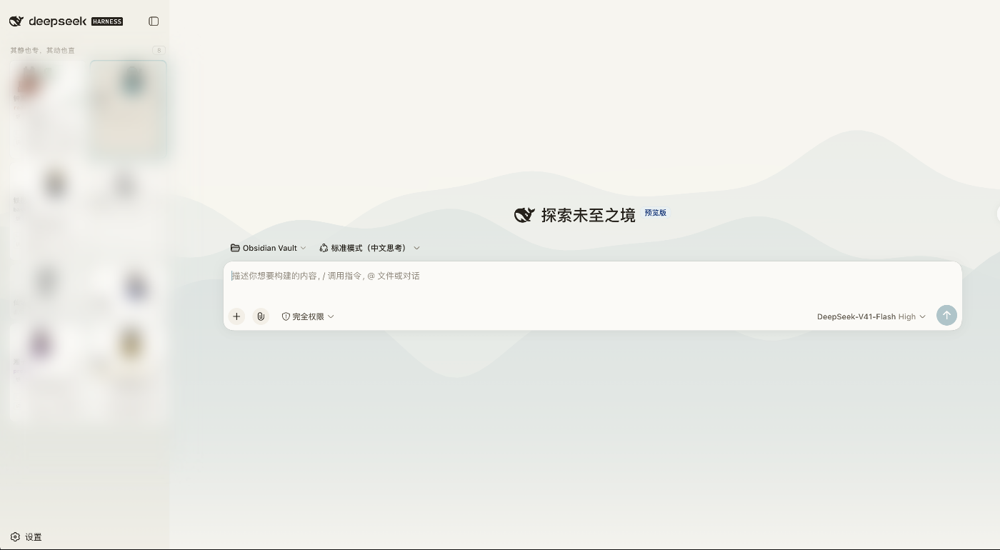
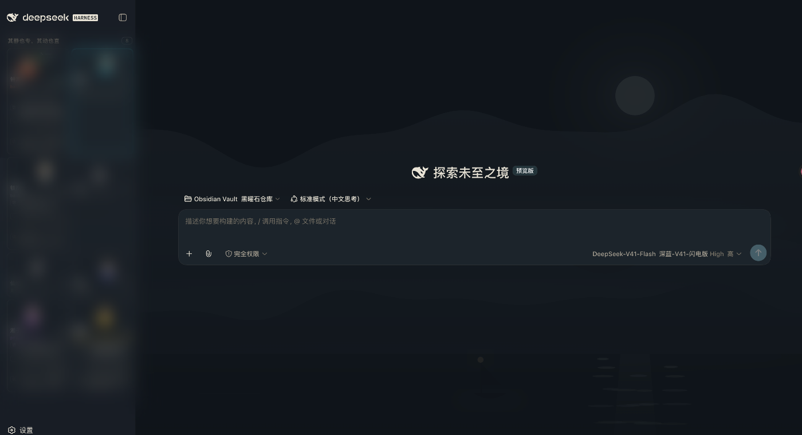

# 宋律 · Songgrid

> 宋代美学 × 瑞士国际主义 —— 给 **DeepSeek Harness** Web UI 的一套主题。

**中文** ｜ [English](README.md)

[](https://www.npmjs.com/package/dsh-theme-songgrid)
[](#license)
[](https://github.com/topics/dsh-plugin)
[](#兼容性)

---

| 宣纸 · 浅色 | 夜墨 · 深色 |
| --- | --- |
|  |  |

> 两个变体的实机截图（侧栏是[定员八席](https://github.com/yefengliu1/dsh-agent-grid)看板）。*卡片区域已打码。*

## 为什么是「宋律」

宣纸的暖白、汝窑的天青、朱砂的警醒 —— 加上瑞士国际主义的尺度纪律：4pt 间距阶、2/4px 圆角、字号与行高严格对应。

不是把古风贴到界面上，而是**让传统色各自落在合适的功能位上**。

### 两个强调色，两个职责

整套主题里唯一一处"看起来像同一个角色、其实必须分开"的决策：

| 角色 | 色 | 对比度（宣纸底） | 落点 |
| --- | --- | ---: | --- |
| **功能色** · 汝窑天青 | `#3A7284`  | **4.91 : 1** ✓ AA | 按钮 · 焦点环 · 选中态 · 链接 |
| **编辑性强调** · 窑铜 | `#9A6B50`  | 4.19 : 1 | 引用块 · 标记 |

> 天青过 WCAG AA，能承担"能不能点、选没选中"；窑铜不过正文 AA，所以它只做"值不值得多看一眼"。
> 两者色相相隔 **174°**，几乎是对比色 —— 它们从来不是同一个角色的两个候选。

## 两个变体

| 变体 | id | 气质 |
| --- | --- | --- |
| **宣纸** | `song-grid-xuanzhi` | 宣纸暖白 × 汝窑天青 × 朱砂 |
| **夜墨** | `song-grid-yemo` | 冷蓝黑 × 提亮天青 |
| **跟随系统** | `system` | 随宿主深浅色自动切换 |

## 色板

### 宣纸 · 浅色

| 角色 | 值 | |
| --- | --- | --- |
| 纸底 | `#F7F5EF` |  |
| 表面 +1 | `#FBFAF6` |  |
| 表面 +2 | `#F0EDE4` |  |
| 叠层 | `#E7E3D8` |  |
| 细线 | `#DDD8CB` |  |
| 主文 · 墨 | `#26221C` |  |
| 次级文字 | `#5C554A` |  |
| 三级文字 | `#8B8478` |  |
| 品牌 / 功能 | `#3A7284` |  |
| 编辑性强调 | `#9A6B50` |  |
| 成功 | `#4E7A5A` |  |
| 警告 | `#B0823A` |  |
| 朱砂 · 错误 | `#B5453C` |  |

### 夜墨 · 深色

| 角色 | 值 | |
| --- | --- | --- |
| 夜墨底 | `#10151A` |  |
| 表面 +1 | `#191F26` |  |
| 表面 +2 | `#1D242B` |  |
| 主文 | `#E8E3D6` |  |
| 次级文字 | `#A8A193` |  |
| 三级文字 | `#7A7468` |  |
| 品牌 / 功能 | `#7FB4C4` |  |
| 错误 | `#D07A70` |  |

> 深色地是**冷蓝黑**而不是暖黑 —— 它和天青是配套调过的，换暖黑等于整套深色重调一轮。

## 排版

- **中文**走宋体（`Noto Serif SC`），**拉丁**走无衬线 —— 两边各归各位，绝不混用
- 字号与行高成对定义，正文、次级、说明各一档
- 强调不靠加粗堆叠，靠**颜色角色**（见上文的天青 / 窑铜分工）

## 结构层

主题分三层，其中两层**与颜色正交** —— 以后调色，它们一行都不用改：

| 层 | 内容 | 含颜色 |
| --- | --- | :---: |
| `STRUCTURE_CSS` | 间距阶（4pt grid + 用途别名）· 圆角 2/4px · 行高 4 档 · 动效 5 时长 3 曲线 · 焦点环 · 图标尺寸 | 否 |
| `ICON_CSS` | 46 个 Lucide mask 图标，`currentColor` 自动跟随 | 否 |
| `SEMANTIC_CSS` | 强调角色分工（`--sg-accent-functional` / `--sg-accent-editorial`） | 是 |

## 安装

```bash
dsh plugin --profile web add dsh-theme-songgrid
```

装好后**刷新页面**，进入 **设置 → 通用 → 主题**，选择「宋律 · 宣纸」「宋律 · 夜墨」或「跟随系统」。选择会持久化在 `songgrid` settings namespace 里。

## 兼容性

- 验证于 **DSH 0.1.5-rc.2**（`@deepseek-ai/dsh`）
- 通过宿主 design token 覆盖实现，**不改宿主源码**、不写裸值
- 与 DeepSeek 官方无隶属关系（Not affiliated with DeepSeek）

## 开发

```bash
# 本仓库结构
lib/index.js      host 半边：注册 songgrid settings namespace
lib/client.js     浏览器半边：主题 token + 三层 CSS + 主题选择器
assets/           青绿山水背景（ink / ink-night / celadon）
```

- **改结构层**：token 集中在 `:root`，加档位只动那一处；新样式按角色取 `var(--sg-gap-*)` / `var(--sg-radius-*)`，别写裸值
- **用图标**：`<span class="sg-icon sg-icon-check"></span>`，46 个字形见 `ICON_CSS`；尺寸用 `.sm` / `.lg` / `.xl` 或 `--sg-icon-size`
- **扩编辑性强调**：`SEMANTIC_CSS` 里已有 `--sg-accent-editorial`，加落点即可 —— 唯一要求是**不要落到交互控件上**，那是功能色的位

## License

MIT
